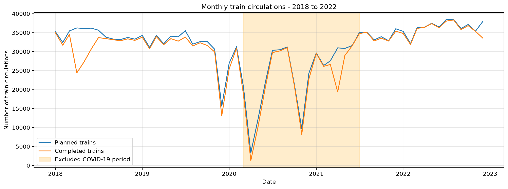
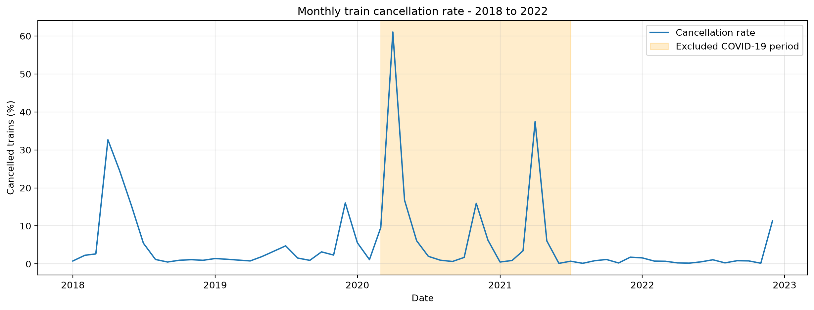
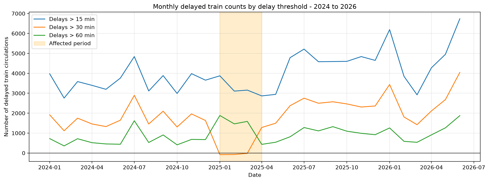
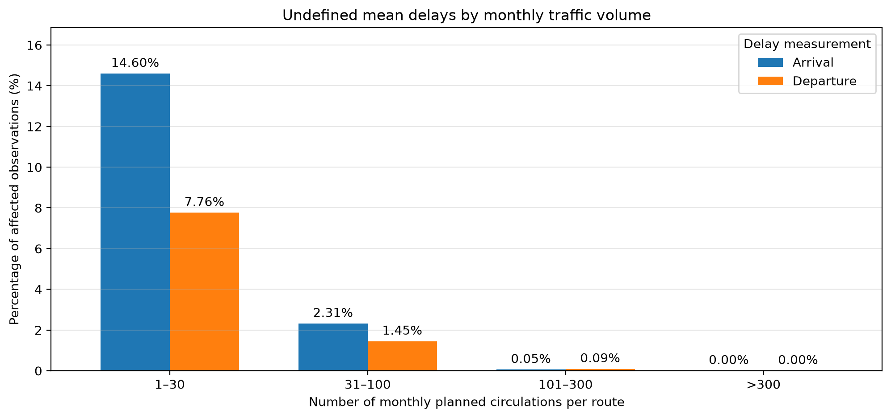
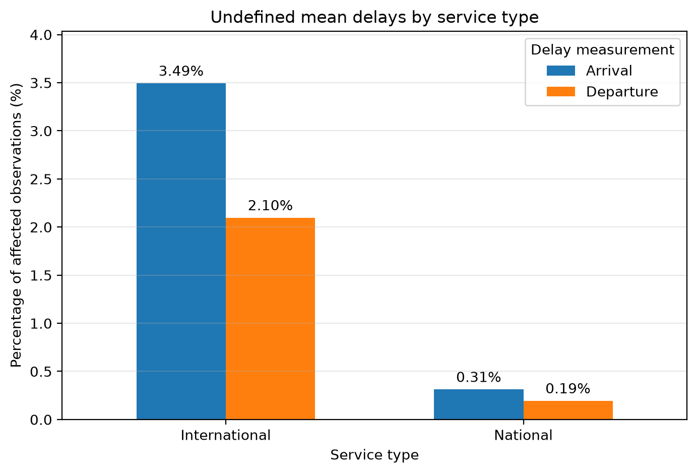
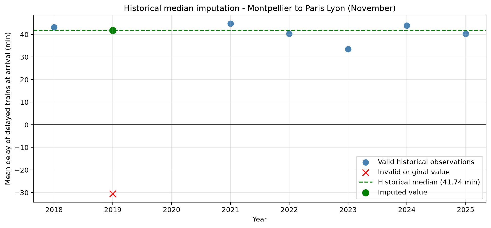
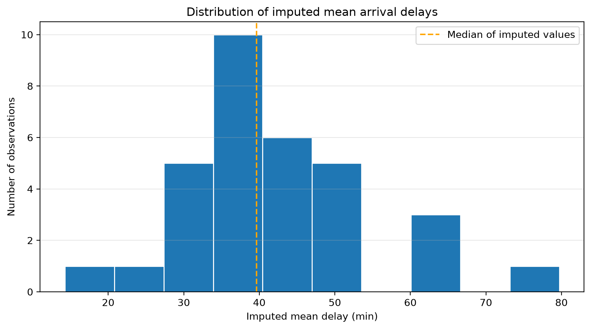
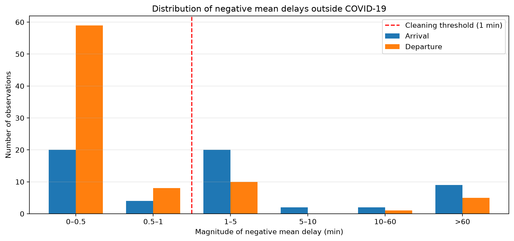
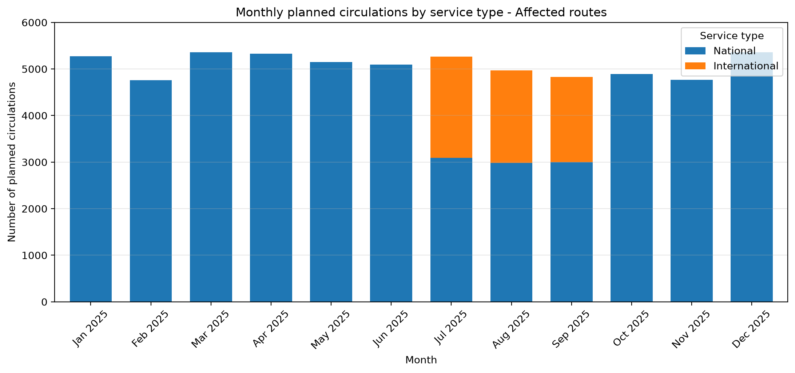
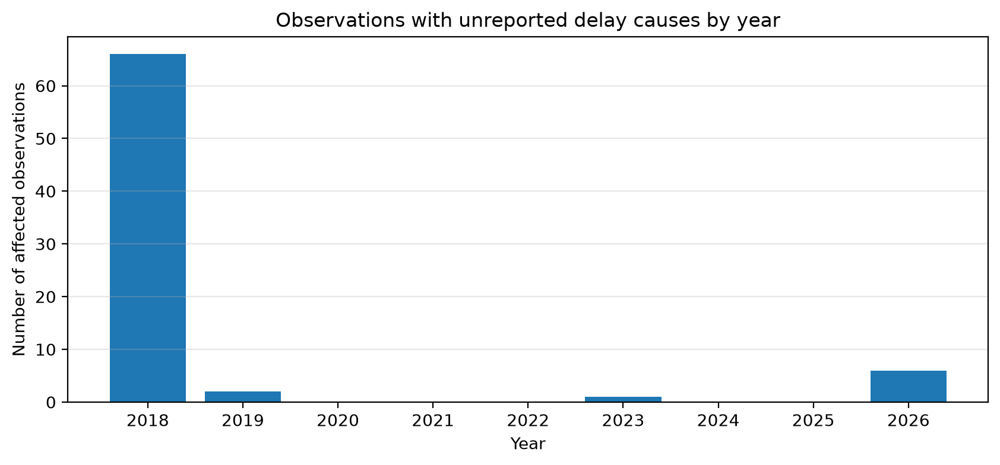

# Dataset Datasheet

> Working template inspired by Gebru et al., “Datasheets for Datasets” (2021). It is intended to document the project’s datasets.
> > GenAI was used to improve the English wording of some sentences.

## 1. Identification and Motivation

- **Dataset name:** regularite-mensuelle-tgv-aqst.csv
- **Version or reference date:** October 17th, 2026
- **Datasheet owner:** SNCF Voyageurs
- **Date created / last updated:** October 2nd, 2026 / October 17th, 2026
- **Why was this dataset created or selected?** SNCF Streamlit project
- **What task or need is it intended to address?** Give customer an overview of traffic state on a trip (e.g. for planning) : train reliability, based on train delays, cancellations (amount, time and causes) for a given period of time.
- **Who created it, and on behalf of which organization?** SNCF Voyageurs
- **Who funded its creation, if applicable?** N/A
- **Other comments:**N/A

## 2. Composition

- **What does one row (or instance) represent?** Each row represents monthly aggregated railway performance statistics for a given directional TGV route and service type.
- **What types of instances does it contain?** integers, strings, floats
- **How many instances does it contain?** 12544 instances × 26 features
- **What is its temporal and geographic coverage?** Geographic coverage maps whole France TGV stations, and neighbor connecting countries (Barcelona, Madrid, Zurich, Francfort, Stuttgart, Genova, Lausanne, Italy).
- **Is it a sample?** No, it is the set of TGV routes monitored by the SNCF.
- **What variables does it contain?** 
  - 4 identification columns: date, service (National: 11,012 rows; International: 1,532 rows), departure and arrival stations;
  - average trip duration;
  - planned circulations and cancelled trains;
  - delays at departure and at arrival: counts and means, with or without on-time trains;
  - trains delayed by more than 15, 30 and 60 minutes;
  - 6 columns of delay-cause percentages;
  - 3 comment columns.
  **How are train delays defined and measured?**
According to the official SNCF dataset documentation, a TGV is considered on time if its delay at the final destination is below a threshold that depends on the journey duration:
- 5 minutes for journeys lasting less than 1 hour and 30 minutes.
- 10 minutes for journeys lasting between 1 hour and 30 minutes and 3 hours.
- 15 minutes for journeys lasting more than 3 hours.
Arrival times are measured using sensors that detect trains entering stations or, in exceptional cases, through manual monitoring. Measurements are rounded down to the nearest minute.
- **Are there targets, labels, or relationships between instances?** none, the dataset is descriptive.
- **Are any missing values, errors, duplicates, or sources of noise known?** 
  - 0 missing values in the numeric columns;
  - the cancellation and departure comment columns are 100 % empty; the arrival comment column is filled in only 698 rows;
  - 84 rows share the same date (month), departure and arrival stations, forming 42 duplicate groups across 14 directional routes. Each group contains one National and one International service observation. These observations are merged during preprocessing (transformation 8).
  - 73 rows have zero planned circulations, including 63 rows reporting more cancelled trains than planned circulations. All these observations fall within the excluded COVID-19 period and are addressed by transformations described below.
  - 31 rows have more trains delayed by more than 15 min than trains delayed at arrival;
  - 40 rows have delayed trains but a mean delay ≤ 0;
  - negative mean delays exist, down to −472 min (53 values below −1 min at arrival);
  - delay causes that do not sum to 100 %: 275 rows below 99.9 %, 270 of them at 0.
- **Does the dataset depend on other files, datasets, or external services?** `liste-des-gares.csv` (6,469 rows) and `lignes-par-region-administrative.csv` (2,909 rows) for the map. They are joined through a hand-written name mapping in `railway_data/__init__.py`.
- **Are recommended splits available** (training, validation, test)? N/A
- **Does the dataset relate to people or allow them to be identified directly or indirectly?** N/A
- **Does it contain confidential or sensitive information, or information that could cause harm?** N/A
- **Other comments:** N/A

## 3. Collection Process

- **How was the data obtained?** Via third-party SNCF Voyageurs, via open data, aggregated monthly
- **What procedures, sources, tools, or APIs were used?** The raw csv file has been downloaded once, and stored in data/raw.
- **What sampling strategy was used, if applicable?** N/A
- **When was the data collected?** It was collected in September 2026, including data up to 06/2026.
- **Who was involved in data collection, and under what conditions?** Only project contributors
- **If people are involved:** N/A
- **Was an ethics review or impact assessment conducted?** N/A
- **Other comments:** N/A

## 4. Preprocessing, Cleaning, and Labeling

- **What transformations were applied?**  

#### Transformation 1 — Invalidation of the COVID-19 period

**Transformation applied**

All data from March 2020 to June 2021 (inclusive) were replaced with `NaN`, except for the four identification columns: date, service, departure station and arrival station.

The records were retained to preserve the temporal structure of the dataset.

**Impact of the transformation**

- 16 months affected.
- 1,953 rows affected, representing 15.57% of the original dataset.
- No rows removed.

**Data analysis and rationale**

These observations are not considered erroneous but unrepresentative of usual railway operating conditions for the intended analysis.

The COVID-19 pandemic significantly disrupted railway operations between March 2020 and June 2021. An exploratory data analysis was conducted to assess the impact of this period on train circulations, cancellations and arrival delays. This analysis led us to conclude that railway operating conditions during this period were too exceptional to be included in analyses intended to reflect normal railway performance.

The following table compares the average monthly indicators before, during and after the excluded period.

| Indicator | 2018–2019 | March 2020 – June 2021 | July 2021 – December 2022 |
|---|---:|---:|---:|
| Planned circulations | 33,060 | 23,915 | 35,765 |
| Completed circulations | 31,329 | 22,243 | 35,291 |
| Cancellation rate | 5.27% | 10.59% | 1.29% |
| Arrival delay rate | 15.92% | 13.08% | 13.60% |

(Note : Cancellation and arrival delay rates were first calculated for each month, and their arithmetic means were then computed for each period.)

During the selected COVID-19 period, several railway performance indicators exhibited unusually extreme values. The average monthly number of completed circulations decreased by approximately 29% compared with 2018–2019, while the average monthly cancellation rate roughly doubled.

The following examples illustrate the magnitude of the unusual fluctuations in railway traffic and cancellation rates during this period. Representative months from 2019 and 2022 are included as reference points for normal railway operating conditions.

| Month | Planned circulations | Completed circulations | Cancellation rate |
|---|---:|---:|---:|
| August 2019 | 31,972 | 31,484 | 1.53% |
| February 2020 | 31,293 | 30,944 | 1.12% |
| **April 2020** | **3,325** | **1,295** | **61.05%** |
| **November 2020** | **9,757** | **8,202** | **15.94%** |
| **April 2021** | **30,993** | **19,382** | **37.46%** |
| July 2021 | 34,998 | 34,754 | 0.70% |
| March 2022 | 36,385 | 36,136 | 0.68% |

Compared with representative months before and after the selected period, several months during the pandemic exhibit exceptionally low traffic volumes or unusually high cancellation rates.

These repeated disruptions highlight the instability of railway operating conditions during this period. We therefore concluded that the corresponding data were not representative of normal railway operations and that their inclusion could bias historical performance statistics.

Although the cancellation rate had returned to a low level in June 2021 (0.13%), the number of planned circulations remained approximately 13% below the median observed in June of the reference years (2018, 2019 and 2022–2025), suggesting that railway services had not yet fully recovered.
From July 2021 onwards, traffic volumes returned to levels comparable to those observed before the pandemic, while cancellation rates remained relatively low over the following months.
These observations suggest a return to more typical railway operating conditions and support our methodological decision to exclude the period from March 2020 to June 2021, inclusive.

Further exploratory data analysis revealed 73 observations with zero planned circulations, including 63 observations reporting more cancelled trains than planned circulations. All these observations occurred in 2020 and fall within the excluded COVID-19 period. No such observations were found outside this period.

Consequently, these inconsistencies are already addressed by this transformation, and no additional cleaning operation is required.

**Methodological limitations**

The excluded period represents a methodological choice based on the observed disruptions and the recovery in railway traffic from July 2021 onwards. Its boundaries were determined through exploratory data analysis. 
Some individual railway lines or months within this period may nevertheless have experienced almost normal operating conditions.

#### Transformation 2 — Invalidation of inconsistent delay counts in Q1 2025

**Transformation applied**

All values from January to March 2025 (inclusive) in the following two columns were replaced with `NaN`:

- "Nombre trains en retard > 30min"
- "Nombre trains en retard > 60min"

All other variables were left unchanged by this transformation.

**Impact of the transformation**

- 3 months affected.
- 363 rows affected, representing 2.89% of the original dataset.
- 726 values replaced with `NaN`.
- No rows removed.

**Data analysis and rationale**

An exploratory data analysis revealed significant inconsistencies in the number of trains delayed by more than 30 and 60 minutes during the first quarter of 2025.

By definition, the number of trains delayed by more than 60 minutes cannot exceed the number of trains delayed by more than 30 minutes. Similarly, the number of delayed trains cannot be negative.

The graph shows a clear disruption in the relationship between the different delay indicators during the first quarter of 2025. Surprisingly, even the aggregated monthly counts of trains delayed by more than 30 minutes are negative during this period.

| Month | Delays > 15 min | Delays > 30 min | Delays > 60 min |
|---|---:|---:|---:|
| November 2024 | 3,982 | 1,962 | 682 |
| December 2024 | 3,655 | 1,631 | 674 |
| **January 2025** | **3,873** | **−81** | **1,882** |
| **February 2025** | **3,106** | **−74** | **1,462** |
| **March 2025** | **3,156** | **−16** | **1,586** |
| April 2025 | 2,865 | 1,280 | 434 |
| May 2025 | 2,942 | 1,496 | 540 |
| June 2025 | 4,784 | 2,374 | 815 |

A more detailed analysis was conducted at the individual row level:

| Month | Total rows | Negative counts (>30 min) | Counts >60 min exceeding counts >30 min |
|---|---:|---:|---:|
| January 2025 | 121 | 18 | 118 |
| February 2025 | 121 | 15 | 117 |
| March 2025 | 121 | 10 | 119 |
| **Q1 2025** | **363** | **43** | **354** |
| All other months | 12,181 | 0 | 0 |

Overall, 97.5% of the observations during the first quarter of 2025 exhibit inconsistencies between the two delay thresholds. None of these two types of anomalies were observed outside this period.
The temporal concentration of these anomalies suggests a systematic issue in the data production or publication process during this period rather than isolated errors.

We therefore decided to invalidate both indicators for the entire quarter, including the few observations that did not exhibit visible inconsistencies.

**Methodological limitations**

The exact origin of these anomalies could not be determined from the available dataset. It was also not possible to establish which of the two indicators contained reliable values or to reconstruct the correct values.
Consequently, both indicators were invalidated as a precautionary measure rather than corrected or imputed. This conservative approach may result in the loss of some potentially valid information.

#### Transformations 3 and 4 — Handling undefined mean delays at arrival and departure

**Transformation applied**

- Transformation 3: when no train was delayed at arrival, the corresponding mean delay of delayed trains was replaced with `NaN` if its original value was equal to zero.
- Transformation 4: when no train was delayed at departure, the corresponding mean delay of delayed trains was replaced with `NaN`, regardless of its original value.

**Impact of the transformations**

| Indicator | Transformation 3 (arrival) | Transformation 4 (departure) |
|---|---:|---:|
| Affected rows in the original dataset | 192 | 130 |
| Rows already invalidated by transformation 1 (COVID-19) | 118 | 85 |
| Additional values replaced with `NaN` | 74 | 45 |
| Percentage of the original dataset affected | 0.59% | 0.36% |
| Rows removed | 0 | 0 |

**Data analysis and rationale**

As explained below, retaining these undefined mean delays as numerical values could have biased historical statistics, particularly means, medians and quantiles. These biases would potentially affect low-traffic routes and international services more frequently.

When no train is delayed, the mean delay of delayed trains is mathematically undefined, since there are no observations from which to calculate a mean. A value of zero is therefore misleading in this context.

For arrival delays, all 192 observations with no delayed trains reported a mean delay of zero. For departure delays, two observations reported a positive mean delay despite having no delayed trains:

| Month | Departure station | Arrival station | Delayed trains at departure |	Mean delay of delayed trains at departure (min) |
|---|---|---|---:|---:|
| June 2018 | Marseille St Charles | Madrid | 0 | 1 |
| June 2018 | Tourcoing | Marseille St Charles | 0 | 1 |

This explains the difference in the conditions applied by transformations 3 and 4.

A further exploratory data analysis (excluding the COVID-19 period) revealed that these observations were not uniformly distributed across the dataset. They were particularly frequent on routes with low monthly traffic volumes.

Outside the COVID-19 period, the median number of monthly planned circulations was 240 across all observations, compared with only 29 and 30 for observations affected by transformations 3 and 4, respectively.

Among observations with 1 to 30 planned circulations, 14.60% were affected by transformation 3 and 7.76% by transformation 4. No affected observations were found among routes with more than 300 monthly planned circulations.

A similar pattern was observed when comparing national and international services.

For transformation 3, 3.49% of international service observations were affected, compared with 0.31% of national service observations. For transformation 4, these proportions were 2.10% and 0.19%.
So we can notice that the affected observations were approximately eleven times more frequent among international services than among national services. This difference may partly be explained by lower traffic volumes on some international routes.

The relationship between traffic volumes, service types and the frequency of undefined mean delays is descriptive. No causal relationship was established.

**Methodological limitations**

Replacing undefined mean delays with `NaN` ensures that they are excluded from statistical calculations that ignore missing values. However, it also reduces the number of valid observations available for historical delay distributions.

#### Transformation 5 — Historical median imputation of invalid arrival delays

**Transformation applied**

When at least one train was delayed at arrival but the corresponding mean delay of delayed trains was less than or equal to zero, the value was considered invalid.

Invalid values were replaced with the median of valid observations for the same service, departure station, arrival station and calendar month, using data from 2018 to 2025 and excluding the COVID-19 period.

A minimum of two valid reference observations was required. Otherwise, the value was replaced with `NaN`.

**Impact of the transformation**

- 40 invalid observations identified in the original dataset.
- 8 observations already invalidated by transformation 1 (COVID-19).
- 32 values successfully imputed, representing 0.26% of the original dataset.
- No rows removed.

**Data analysis and rationale**

When at least one train is delayed at arrival, the mean delay of delayed trains must be strictly positive. However, outside the COVID-19 period, 30 observations reported a mean delay of zero and 2 reported negative values.

The historical median was selected as an imputation method because it is less sensitive to extreme values than the arithmetic mean. Selecting observations from the same service, route and calendar month also accounts for route-specific characteristics and potential seasonal patterns.

The following graph illustrates the imputation method using the Montpellier–Paris Lyon route as an example. In November 2019, 44 trains were delayed at arrival, but their reported mean delay was negative (-30.51 minutes).

The invalid value was replaced with the historical median of 41.74 minutes, calculated using six valid observations for the same route, service and calendar month. November 2020 was excluded because it falls within the COVID-19 period.

A comparative analysis was conducted to assess the impact of this imputation method on the overall delay statistics. Compared with simply replacing invalid values with `NaN`, historical median imputation increased the overall arithmetic mean by only 0.016 minutes and the overall median by 0.010 minutes.

These results suggest that the selected imputation method preserves useful information while having a negligible impact on the overall delay statistics.

The following graph shows the distribution of the 32 imputed values.

| Indicator | Imputed values |
|---|---:|
| Minimum | 14.26 min |
| Median | 39.63 min |
| Mean | 41.93 min |
| Maximum | 79.73 min |

All 32 invalid values could be imputed using between two and six valid historical observations.

**Methodological limitations**

Imputed values are estimates rather than actual measurements. Their reliability depends on the number and representativeness of the available reference observations.

Median imputation may also artificially reduce the variability of historical delay distributions.

Finally, the reference period may include observations collected after the date of the invalid value. This approach is therefore intended for retrospective descriptive analysis rather than predictive modelling.

#### Transformation 6 — Invalidation of inconsistent counts of trains delayed by more than 15 minutes

**Transformation applied**

Values in the column "Nombre trains en retard > 15min" were replaced with `NaN` when they exceeded the total number of trains delayed at arrival ("Nombre de trains en retard à l'arrivée").

**Impact of the transformation**

- 31 inconsistent observations identified in the original dataset.
- 18 observations already invalidated by transformation 1 (COVID-19).
- 13 additional values replaced with `NaN`, representing 0.10% of the original dataset.
- No rows removed.

**Data analysis and rationale**

The number of trains delayed by more than 15 minutes should not exceed the total number of trains delayed at arrival.

However, exploratory data analysis revealed 31 observations that did not satisfy this condition. All of them occurred between January 2018 and November 2020.

The following table presents some examples of inconsistent observations outside the COVID-19 period.

| Month | Departure station | Arrival station | Delayed trains at arrival | Trains delayed >15 min |
|---|---|---|---:|---:|
| January 2018 | Grenoble | Paris Lyon | 23 | **25** |
| February 2018 | Paris Est | Nancy | 38 | **44** |
| February 2018 | Grenoble | Paris Lyon | 35 | **41** |
| May 2019 | Paris Lyon | Barcelona | 7 | **12** |
| May 2019 | Barcelona | Paris Lyon | 7 | **13** |
| December 2019 | Francfort | Paris Est | 13 | **18** |

For the 13 observations affected by this transformation, the difference between the two indicators ranged from one to six trains, with a median difference of two trains.

As the correct values could not be reconstructed from the available data, we decided to invalidate the inconsistent counts of trains delayed by more than 15 minutes rather than introduce arbitrary corrections.

**Methodological limitations**

The exact origin of these inconsistencies could not be determined. The selected approach assumes that the total number of trains delayed at arrival is more reliable than the number of trains delayed by more than 15 minutes, although this assumption could not be verified.

#### Transformation 7 — Handling negative mean delays for all trains

**Transformation applied**

The following rules were applied to two variables ("Retard moyen de tous les trains à l'arrivée" and "Retard moyen de tous les trains au départ"):

- Negative values greater than or equal to −1 minute were replaced with zero.
- Negative values below −1 minute were replaced with `NaN`.
- Non-negative values were left unchanged.

**Impact of the transformation**

| Indicator | Arrival | Departure |
|---|---:|---:|
| Negative values in the original dataset | 121 | 170 |
| Values already invalidated by transformation 1 (COVID-19) | 64 | 87 |
| Values replaced with zero | 24 | 67 |
| Additional values replaced with `NaN` | 33 | 16 |
| Total values modified | 57 | 83 |

Overall, 140 values across 134 distinct rows were modified. No rows were removed.

**Data analysis and rationale**

Exploratory data analysis revealed numerous negative mean delays at both departure and arrival.

The official SNCF dataset documentation was reviewed to determine whether early departures or arrivals were recorded as negative delays. No information confirming such a calculation method was found.
The official SNCF dataset documentation describes the thresholds used to define train punctuality and the methods used to measure arrival times (see Section 2)

Some observations also exhibited extremely negative mean delays, as illustrated in the following table.

| Month | Departure station | Arrival station | Measurement | Mean delay (min) |
|---|---|---|---|---:|
| December 2019 | Strasbourg | Nantes | Arrival | −472.64 |
| December 2019 | Lyon Part Dieu | Montpellier | Arrival | −173.08 |
| February 2020 | Paris Est | Francfort | Arrival | −163.04 |
| November 2019 | Barcelona | Paris Lyon | Departure | −229.27 |
| November 2019 | Nimes | Paris Lyon | Departure | −112.26 |
| October 2019 | Nimes | Paris Lyon | Departure | −92.77 |

The following graph shows the distribution of negative mean delays outside the COVID-19 period.

Among the 140 negative values identified outside the COVID-19 period, 79 had an absolute value of 30 seconds or less, and 91 had an absolute value of one minute or less. Conversely, 14 values had an absolute value exceeding one hour.

We therefore decided to distinguish slightly negative values from larger negative values. Slightly negative values were replaced with zero to preserve the observations while limiting the impact of the correction on delay statistics.

A comparative analysis confirmed that replacing these 91 values with zero had a negligible impact on the overall arithmetic means.

| Indicator | Arrival | Departure |
|---|---:|---:|
| Mean before correction (min) | 6.534185 | 3.371056 |
| Mean after correction (min) | 6.534863 | 3.372389 |
| Relative variation | +0.010% | +0.040% |

*Note: This comparison isolates the impact of replacing slightly negative values with zero, without invalidating values below −1 minute.*

Larger negative values were invalidated because their meaning and reliability could not be established from the available data and documentation.

As mentionned above, several observations exhibited extremely negative mean delays. For example, the reported mean arrival delay was −472.64 minutes on the Strasbourg–Nantes route in December 2019, −173.08 minutes on the Lyon Part Dieu–Montpellier route in December 2019, and −163.04 minutes on the Paris Est–Francfort route in February 2020. Similarly, a mean departure delay of −229.27 minutes was recorded on the Barcelona–Paris Lyon route in November 2019.

Given the magnitude of these values and the lack of documentation explaining their meaning, retaining them could artificially reduce average delay estimates and distort historical performance statistics, particularly for the affected routes.

Invalidating negative values below −1 minute increased the overall arithmetic mean from 6.534 to 6.698 minutes at arrival and from 3.371 to 3.433 minutes at departure. This illustrates the potential influence of these values on delay statistics.

**Methodological limitations**

The −1 minute threshold represents a methodological choice supported by exploratory data analysis rather than a formally established statistical threshold.

Although replacing slightly negative values with zero has a negligible impact on arithmetic means, its impact on individual route statistics may vary.

The exact origin and meaning of negative mean delays could not be established from the available documentation.

#### Transformation 8 — Merging duplicate monthly route observations

**Transformation applied**

Observations sharing the same date, departure station and arrival station were merged.

Different aggregation methods were applied depending on the nature of each variable. Train counts (planned circulations, cancellations and delayed trains) were summed. 
Mean journey durations and mean delays of all trains were weighted by the number of completed circulations. 
Mean delays of delayed trains were weighted by the corresponding number of delayed trains (at departure, at arrival or by more than 15 minutes). 
Delay-cause percentages were weighted by the number of trains delayed at arrival.

Missing numerical values were replaced with zero before aggregation. The `Service` column was set to `NaN` for merged observations, as they combine both national and international services.

**Impact of the transformation**

- 84 rows involved in 42 duplicate groups.
- 14 directional routes affected, corresponding to 7 railway connections in both directions.
- 3 months affected (July to September 2025).
- Dataset reduced from 12,544 to 12,502 rows.
- Total train counts preserved.

**Data analysis and rationale**

Exploratory data analysis revealed 42 cases where two observations shared the same date, departure station and arrival station. These observations were not identical: each pair consisted of one national and one international service.

Interestingly, all these cases occurred during the third quarter of 2025 and involved the same seven railway connections in both directions, all located within France.

The following graph shows the evolution of monthly planned circulations for the affected routes throughout 2025.

During the third quarter of 2025, the appearance of international services coincided with a significant decrease in national circulations, while the combined volume remained relatively stable.

These observations suggest a temporary change in the classification of railway services rather than a duplication of train counts.

We therefore decided to merge these observations rather than discard one of the two records, which could have resulted in a significant loss of information.

The following example illustrates the aggregation method for the Paris Est–Strasbourg route in July 2025.

| Indicator | National | International | Merged observation |
|---|---:|---:|---:|
| Planned circulations | 352 | 252 | **604** |
| Cancelled trains | 1 | 4 | **5** |
| Completed circulations | 351 | 248 | **599** |
| Trains delayed at departure | 62 | 41 | **103** |
| Trains delayed at arrival | 58 | 36 | **94** |
| Mean delay of delayed trains at arrival | 34.49 min | 53.98 min | **41.95 min** |

The merged mean arrival delay was calculated by weighting each original mean by its corresponding number of delayed trains.

This transformation ensures that each monthly route is represented by a single observation, preventing certain months from being overrepresented in historical delay distributions.

**Methodological limitations**

Although the observed traffic patterns support the hypothesis of a temporary change in service classification, it could not be formally established that national and international observations represented distinct populations of trains.

Replacing missing numerical values with zero before aggregation may introduce biases when missing values represent unavailable measurements rather than actual zeros.

The aggregation of delay-cause percentages also assumes that the number of trains delayed at arrival is an appropriate weighting factor.

#### Transformation 9 — Addition of unreported delay causes

**Transformation applied**

A new column, "Prct retard causes non renseignées", was added to the dataset to account for unknown / unreported delay causes.

Its value was calculated by subtracting the sum of the six existing delay-cause percentages from 100%, provided that at least one train was delayed at arrival and that all six percentages were available. Otherwise, the value was set to `NaN`.

**Impact of the transformation**

| Indicator | Number of observations |
|---|---:|
| No unreported delay causes (0%) | 10,401 |
| Partially unreported delay causes | 5 |
| Completely unreported delay causes (100%) | 70 |
| Undefined percentage (`NaN`) | 2,026 |
| Total | 12,502 |

- One additional column created.
- No existing values modified.
- No rows removed.

**Data analysis and rationale**

Adding a dedicated category for unreported delay causes prevents missing percentages from being artificially redistributed among the existing categories when displaying normalized charts.

This additional variable also enables the Meet Your Train application to display a complete breakdown of delay causes, including unreported causes, both for individual railway routes and at the national level.

Exploratory data analysis revealed that the sum of the six existing delay-cause percentages did not always equal 100%, even when trains were delayed at arrival.

The following table illustrates several cases of completely or partially unreported delay causes.

| Month | Departure station | Arrival station | Delayed trains at arrival | Reported causes | Unreported causes |
|---|---|---|---:|---:|---:|
| March 2018 | Marseille St Charles | Madrid | 1 | 0% | **100%** |
| May 2018 | Paris Lyon | Italie | 13 | 0% | **100%** |
| June 2026 | Paris Montparnasse | Laval | 65 | 84.62% | **15.38%** |
| June 2026 | Paris Montparnasse | Quimper | 46 | 86.96% | **13.04%** |
| June 2026 | Paris Montparnasse | Vannes | 56 | 87.50% | **12.50%** |
| June 2026 | Marseille St Charles | Lille | 62 | 98.39% | **1.61%** |

Further analysis revealed that these observations were particularly concentrated in 2018.

Of the 75 affected observations outside the COVID-19 period, 66 occurred in 2018. Furthermore, 67 of the 70 observations with completely unreported delay causes corresponded to international services.

**Methodological limitations**

The additional category represents the difference between 100% and the sum of the reported delay-cause percentages. It is a derived indicator rather than a delay cause directly measured by SNCF.

The exact reasons for the incomplete reporting of delay causes could not be established.

- **Is the raw data retained? Where can it be accessed?** Yes. The original CSV file is retained without modification in the data/raw/ directory of the GitHub repository. All preprocessing transformations are applied programmatically to a copy of the original dataset, ensuring that the raw data remain available for further analysis and verification.
- **What tools, scripts, and versions were used?** Exploratory data analysis and preprocessing were performed using Python, Pandas and NumPy. Jupyter notebooks were used for data exploration, statistical analysis and validation of the selected transformations. Matplotlib was used to produce the visualizations presented in this datasheet.
All 9 preprocessing transformations are implemented in src/core/data_preprocessing.py. Weighted mean calculations used when merging observations are implemented in src/core/statistics/mean_delay.py.
Unit tests were developed using Pytest to verify preprocessing operations and their expected results.
Project dependencies and their versions are managed using uv and documented in the pyproject.toml and uv.lock files.
- **Other comments:** After applying all 9 transformations, the dataset contains 12,502 rows and 27 columns, compared with 12,544 rows and 26 columns in the original dataset.
The preprocessing pipeline is executed when the application loads the dataset, allowing the cleaned data to be regenerated without modifying the original CSV file.

## 5. Uses

- **What has the dataset already been used for?** For a dataset overview, summarizing statistics on the full dataset, inconditionnaly of connections and periods.
https://public.tableau.com/app/profile/aur.lien8073/viz/snc_15838585145650/TGV
- **What other uses are envisioned?** N/A
- **What uses are discouraged or unsuitable, and why?** 
  - comparing routes over different periods without accounting for COVID;
  - interpreting the >30 and >60 min delays of Q1 2025 (invalidated);
  - drawing conclusions about an individual train: only monthly averages are available.
- **What limitations in coverage, quality, or collection could affect results?** 
  - railway operations between March 2020 and June 2021 were significantly disrupted by the COVID-19 pandemic. This period was excluded from historical performance calculations.
  - aggregating mean delays without appropriate weighting may distort train-level performance estimates when the underlying observations represent different numbers of trains.
  - punctuality thresholds depend on journey duration, which should be considered when comparing different railway routes.
  - a single train may be recorded on multiple monitored routes. Aggregated circulation counts do not necessarily represent distinct trains at the national level.
  - some data quality issues could not be fully resolved, as described in Section 4.
- **References to work or systems that use the dataset:** N/A

## 6. Distribution and Access

- **Is the dataset shared outside the organization?** Public dataset
- **Where and how can it be accessed?** 
  - [GitHub repository](https://github.com/pmarlier/streamlit_sncf/tree/main)
  - Application website : https://meet-your-train.streamlit.app/
- **Release date and persistent identifier (DOI), if applicable:** 20/11/2026
- **What license or terms of use apply?** Open Database License (ODbL)
- **Do any third-party rights or restrictions apply?** N/A
- **Are any fees, export controls, or other regulatory restrictions reported?** N/A
- **Other comments:** N/A

## 7. Maintenance

- **Who hosts, maintains, and updates the dataset?** Pierre Marlier, Ulysse Perruchon-Monge, Christophe Vandenborre - Télécom Paris
- **How can the owner be contacted?** [Via github repository](https://github.com/pmarlier/streamlit_sncf/tree/main)
- **Is there an erratum or a channel for reporting issues?** [Via github repository](https://github.com/pmarlier/streamlit_sncf/tree/main)
- **How are older versions retained and identified?** N/A
- **Are there data retention or deletion rules?** N/A
- **Can external contributions or corrections be submitted?** N/A
- **Other comments:** N/A

## 8. Project Source Inventory

Add one row per file or source. Duplicate the sections above if a source needs its own datasheet.

| File or source | Description | Period / coverage | Provenance and access | License / restrictions |
| --- | --- | --- | --- | --- |
| `data/raw/regularite-mensuelle-tgv-aqst.csv` | SNCF TGVs monthly regularity per connexion | 01/2018 to 06/2026 | ressources.data.sncf.com | Open Database License (ODbL) |

## Reference

Gebru, Timnit, et al. “Datasheets for Datasets.” *Communications of the ACM*, 2021. [arXiv:1803.09010](https://arxiv.org/abs/1803.09010).